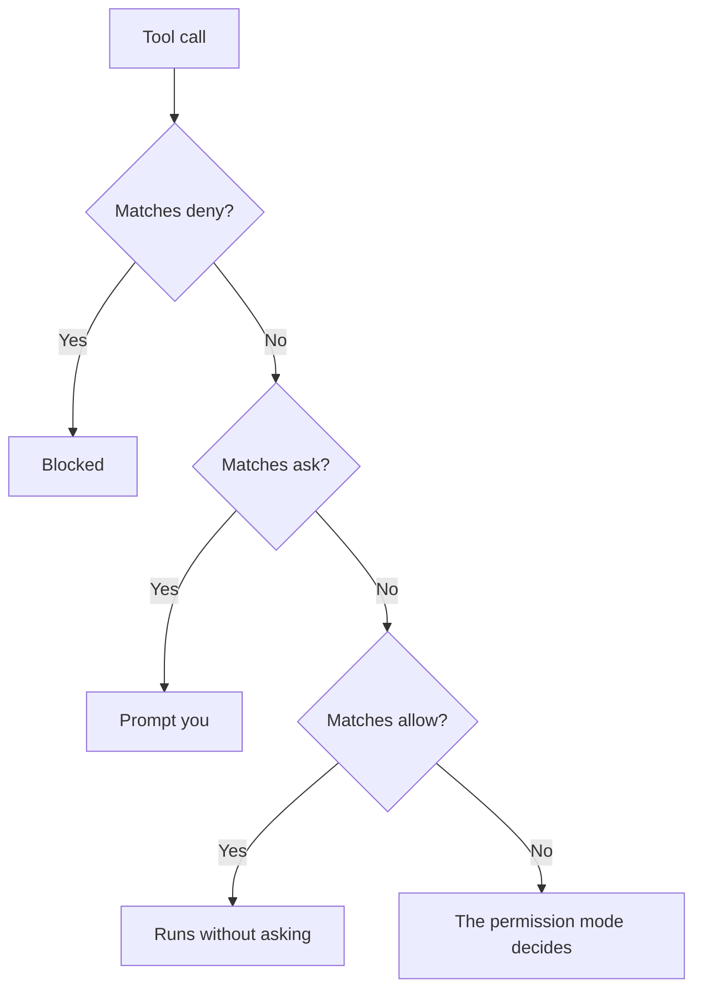

# Claude Code Permission Rules: Summary

Permission rules are JSON settings files that Claude Code reads at startup. They give you fine-grained control over individual tool calls, which the coarse permission modes cannot do.

## Where rules live

| File | Scope |
|------|-------|
| `~/.claude/settings.json` | You, on this machine, every project |
| `.claude/settings.json` | This project; commit it for the whole team |

Inside, a `permissions` object holds up to three arrays of rule strings:

```json
{
  "permissions": {
    "allow": ["Bash(ls:*)", "Bash(git status)"],
    "ask": ["Bash(git push:*)"],
    "deny": ["Bash(rm -rf:*)"]
  }
}
```

## Rule anatomy

A rule is a tool name, optionally followed by a specifier in parentheses. A trailing `:*` turns an exact match into a prefix match.

| Rule string | What it matches |
|-------------|-----------------|
| `Bash(git status)` | That exact command, nothing else |
| `Bash(git push:*)` | A `git push` with any arguments |
| `Edit` | Every use of the Edit tool |
| `Read(./.env)` | Reads of that one file |
| `Edit(/src/**)` | Edits anywhere under `/src` |
| `WebFetch(domain:example.com)` | Fetches of that host |

- A single `*` matches inside one path or command segment.
- `**` spans directories, so it reaches nested files.
- These are the same strings the `--allowedTools` flag takes (topic 005). Putting them in a settings file makes them permanent instead of per-run.

## Compound commands

Claude Code splits compound commands and evaluates every segment of `&&`, `||`, `;`, and pipelines, plus substitutions and redirections. So `git status && rm -rf build` is not treated as a harmless `git status`: the delete is judged on its own, and your deny rule still fires.

## Related boundaries

- `additionalDirectories` widens the files a session may touch beyond its starting directory.
- **Workspace trust** keeps a cloned repository's own allow rules, hooks, and MCP servers inert until you approve the project.

Neither should be granted absent-mindedly.

## Deny wins

When a tool call matches rules in more than one list, the priority is fixed:



- Deny beats allow whenever both match the same call.
- This lets you combine a generous allow list with deny rules that carve out dangerous variants.
- Both settings files are read together, so a deny in your user file holds even in a project whose own file allows more.

## Lab

You write a project-level `.claude/settings.json` by hand. There is no new command to learn; the skill is getting the JSON shape and the rule strings right.