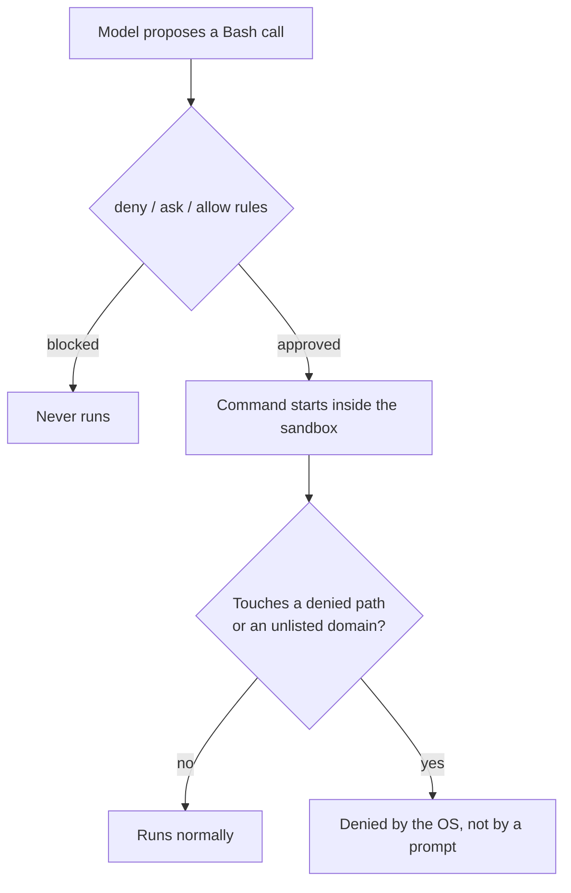

# Permission rules vs. the sandbox

## Summary

- **Two independent layers.** Permission rules decide whether a command may *start*. The sandbox decides what a running command can *reach*. Only the sandbox survives a mistake in the permission rules.
- **OS-level enforcement.** Isolation uses bubblewrap on Linux and WSL2 and Seatbelt on macOS, so the boundary is enforced by the operating system rather than by a hook or a rule string.
- **Configuration.** The sandbox lives under the `sandbox` key in the same settings files as permissions. `autoAllowBashIfSandboxed` skips approval prompts for commands the sandbox can contain, and `failIfUnavailable` makes a session refuse to start when the sandbox cannot be set up.
- **Policies.** Filesystem rules use `allowRead`, `denyRead`, `allowWrite` and `denyWrite`. Network rules use `allowedDomains` and `deniedDomains`, and `strictAllowlist` makes the allow list the only traffic permitted.
- **Credentials.** Denying a file or variable removes it from the sandboxed process. Masking hands the process a sentinel value, and the sandbox proxy substitutes the real secret only for hosts in `injectHosts`, so the secret never enters the model's context.
- **Escape hatch.** Unsandboxed retries are governed by `allowUnsandboxedCommands` and `excludedCommands`, and managed policy can forbid them entirely. `dangerouslyDisableSandbox` is the per-call opt-out.
- **Lab scope.** The lab grades the policy file you write, not the kernel's refusal, because proving containment needs an interactive session with bubblewrap installed.

---

## Full text

Permission rules decide whether a command is allowed to start. The sandbox decides what that command can reach once it is running. They are independent layers, and only the second one survives a mistake in the first.



On Linux and WSL2 the isolation is bubblewrap; on macOS it is Seatbelt. Either way the boundary is enforced by the operating system, which is the part a hook or a rule string cannot give you.

### Turning it on

The sandbox is configured in the same settings files as permissions, under a `sandbox` key:

```json
{
  "sandbox": {
    "enabled": true,
    "autoAllowBashIfSandboxed": true,
    "filesystem": {
      "denyRead": ["./secrets.env"],
      "allowWrite": ["./build"]
    },
    "network": {
      "allowedDomains": ["registry.npmjs.org"],
      "strictAllowlist": true
    }
  }
}
```

`autoAllowBashIfSandboxed` is the payoff key: commands the sandbox can contain stop asking for approval, because containment already answers the question the prompt was asking. Leave it out and both layers apply with prompts intact. `failIfUnavailable` decides whether a session refuses to start when the sandbox cannot be set up, which is the setting an administrator cares about most.

### Filesystem and network policy

Filesystem rules take `allowRead`, `denyRead`, `allowWrite`, and `denyWrite` lists, whose entries can be absolute (`/etc`), home relative (`~/.aws`), or project relative (`./build`). Network rules take `allowedDomains` and `deniedDomains`, and `strictAllowlist` turns the allow list into the only traffic permitted, so a package install that reaches an unexpected host fails instead of succeeding quietly.

| Policy | Keys | Entry styles |
| --- | --- | --- |
| Filesystem | `allowRead`, `denyRead`, `allowWrite`, `denyWrite` | absolute `/etc`, home relative `~/.aws`, project relative `./build` |
| Network | `allowedDomains`, `deniedDomains`, `strictAllowlist` | domain names such as `registry.npmjs.org` |

### Credentials the agent never sees

A token in the environment is readable by anything the agent runs. The `credentials` block handles that two ways:

- **Deny** a file or variable, which removes it from the sandboxed process.
- **Mask** it, which is the more interesting option: the process receives a sentinel value and the sandbox proxy substitutes the real secret when the request leaves for a host listed in `injectHosts`. The command works while the secret never enters the model's context.

`network.tlsTerminate` is what makes that substitution possible on encrypted traffic.

### The escape hatch

When a command genuinely cannot run contained, an unsandboxed retry can be offered, governed by `allowUnsandboxedCommands` and `excludedCommands`. Managed policy can forbid the retry entirely, and `dangerouslyDisableSandbox` is the per-call opt out whose name is a fair summary of the decision.

Inside a session, `/sandbox` shows and toggles the current state.

> **What this lab VM can and cannot show you**
>
> The settings shape above is real and gradable: the lab writes and validates the policy file. Proving containment needs an interactive session on a machine where bubblewrap is installed, so this hour grades the policy you write, not the kernel's refusal.
