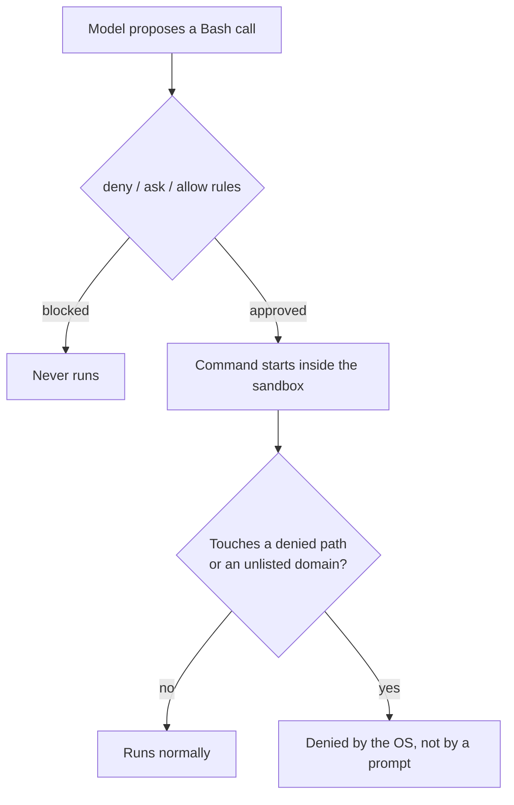

# Claude Code Sandboxing

> **TL;DR:** Permission rules decide whether a command may *start*. The sandbox decides what it can *reach* once running. They are independent layers, and only the sandbox still protects you if a permission rule is wrong.

## Table of Contents

- [How it works](#how-it-works)
- [Enabling the sandbox](#enabling-the-sandbox)
- [Filesystem and network policy](#filesystem-and-network-policy)
- [Credentials the agent never sees](#credentials-the-agent-never-sees)
- [The escape hatch](#the-escape-hatch)
- [Lab note](#lab-note)

## How it works



Isolation is enforced by the operating system:

| Platform | Mechanism |
|---|---|
| Linux / WSL2 | bubblewrap |
| macOS | Seatbelt |

> [!NOTE]
> A hook or a rule string cannot provide this guarantee. Only OS-level enforcement can.

## Enabling the sandbox

Configure it under the `sandbox` key, in the same settings files as permissions:

```json
{
  "sandbox": {
    "enabled": true,
    "autoAllowBashIfSandboxed": true,
    "filesystem": {
      "denyRead": ["./secrets.env"],
      "allowWrite": ["./build"]
    },
    "network": {
      "allowedDomains": ["registry.npmjs.org"],
      "strictAllowlist": true
    }
  }
}
```

| Key | Purpose |
|---|---|
| `autoAllowBashIfSandboxed` | Commands the sandbox can contain stop asking for approval. Omit it and both layers apply, with prompts intact. |
| `failIfUnavailable` | The session refuses to start if the sandbox can't be set up. The setting administrators care about most. |

## Filesystem and network policy

**Filesystem** rules take these lists:

- `allowRead`
- `denyRead`
- `allowWrite`
- `denyWrite`

Entries can be absolute (`/etc`), home-relative (`~/.aws`), or project-relative (`./build`).

**Network** rules take `allowedDomains` and `deniedDomains`. Setting `strictAllowlist` makes the allow list the *only* permitted traffic, so a package install that reaches an unexpected host fails instead of succeeding quietly.

## Credentials the agent never sees

A token in the environment is readable by anything the agent runs. The `credentials` block handles this in two ways:

| Approach | What it does |
|---|---|
| **Deny** | Removes a file or variable from the sandboxed process. |
| **Mask** | The process receives a placeholder value. The sandbox proxy substitutes the real secret when the request goes to a host listed in `injectHosts`. The command works, but the secret never enters the model's context. |

> [!IMPORTANT]
> Masking on encrypted traffic depends on `network.tlsTerminate`.

## The escape hatch

When a command genuinely cannot run contained, an unsandboxed retry can be offered. It is governed by:

- `allowUnsandboxedCommands`
- `excludedCommands`

> [!WARNING]
> Managed policy can forbid the retry entirely. `dangerouslyDisableSandbox` is the per-call opt-out, and its name is a fair summary of the decision.

Inside a session, use `/sandbox` to view and toggle the current state.

## Lab note

The lab VM can write and validate the **policy file**. Proving real containment needs an interactive session on a machine with bubblewrap installed, so this exercise grades the policy you write, not the kernel's refusal.